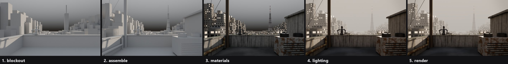
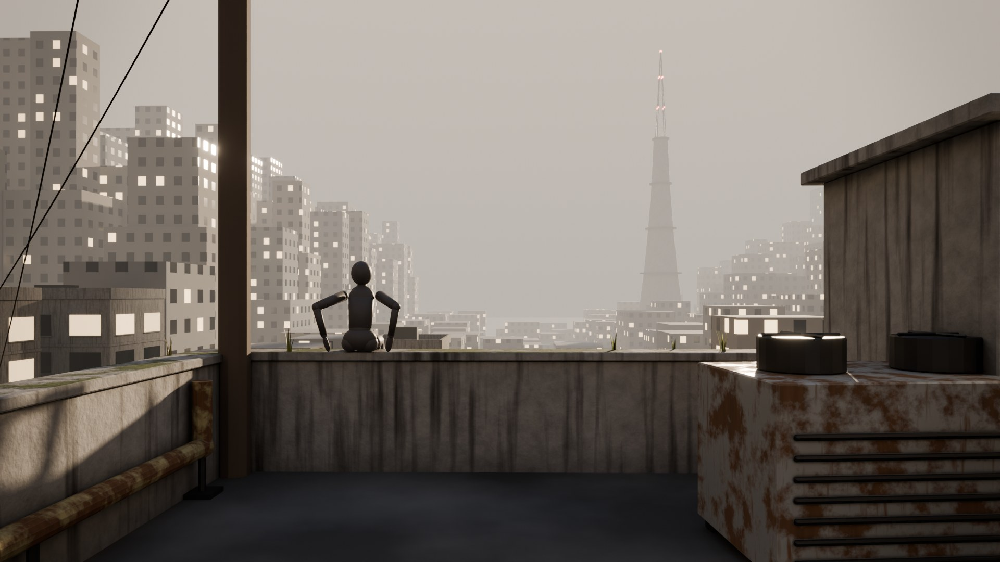
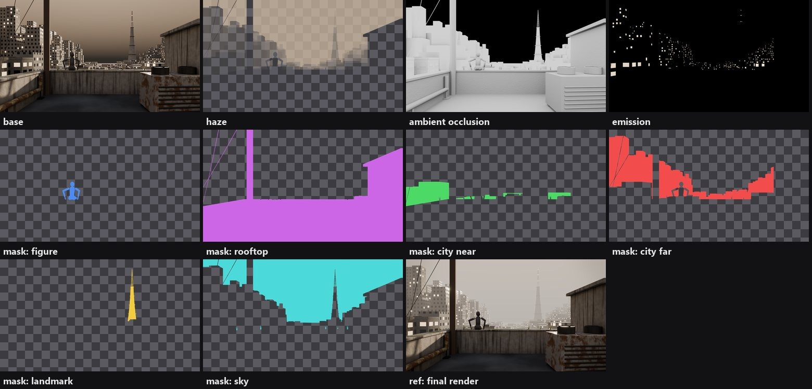

# 3D-Assisted Illustration

[](https://github.com/starryark/3d-assisted-illustration/actions/workflows/ci.yml)

**A reproducible Blender workflow for illustrators and coding agents.** Build a scene that
gives you reliable perspective, scale and light. Render a base image plus the passes and
masks a painter needs. Then hand it to 2D as a layered PSD/ORA. Every stage is a Python
function, every build is seeded, and every checkpoint is checked with numbers, not vibes.



*The worked example, "Above the Haze": blockout → assemble → materials → lighting → render.
Every image above is a checkpoint the pipeline renders and checks automatically.*



It runs headless (`blender --background`), so it works the same on a laptop, in CI, or
driven by an agent such as [Claude Code](https://claude.com/claude-code), which built
this repository and the case study it was generalised from.

## The workflow

| Stage | You write | The checkpoint renders | …and checks |
|---|---|---|---|
| **blockout** | camera(s), simple masses, a character placeholder, one light | clay render, grayscale, thumbnail | contact (sitting, standing, hands), composition (subject and landmark on the thirds, nothing cut off), subject visible by ray-cast |
| **assemble** | detailed geometry at the blockout positions; detail allocated by image size | clay render | props rest on surfaces; the subject is still visible |
| **materials** | one material family; imported materials unified | real materials, neutral light | — |
| **lighting** | sun, sky or HDRI, local accents, haze | the lit image | **subject reads in grayscale** (value separation against its surroundings), exposure in bounds, landmark visible through the haze |
| **render** | — | beauty, haze, mist, AO, emission, object masks → **layered paintover kit** | every pass written; PSD and ORA written; the PSD reads back pixel-exact |

```bash
python tools/run.py scenes/rooftop_city --until blockout     # one checkpoint
python tools/run.py scenes/rooftop_city                      # all five, preview quality (960x540)
python tools/run.py scenes/rooftop_city --quality final      # 1920x1080, 256 spp (~1 min per camera on a GPU)
```

Each stage runs in a fresh Blender process and rebuilds the scene from code up to that
stage. A checkpoint is therefore a reproducible artefact, not a state you had to save at
the right moment. [`docs/WORKFLOW.md`](docs/WORKFLOW.md) explains each stage, and what to
decide in it.

## Quick start

Requirements: **Blender 5.2+** and **Python 3.9+**. A GPU is optional; Cycles falls back to
CPU. There are no other dependencies (the optional PSD read-back tool needs `pip install psd-tools pillow numpy`).

```bash
git clone https://github.com/starryark/3d-assisted-illustration && cd 3d-assisted-illustration
python tools/run.py scenes/rooftop_city --quality draft      # all five stages, ~2 min even on CPU, offline
```

Blender is found via `--blender PATH`, `$BLENDER`, `blender` on PATH, or the default install
location. Outputs go to `out/rooftop_city/`:

```
checkpoints/<stage>_<cam>.png, _gray.png, _thumb.png   what each stage looked like
passes/render_<cam>/beauty, final, haze, mist, ao, emission, mask_*.png
paintover/<cam>/rooftop_city_<cam>.psd / .ora, layers/, masks/, LAYERS.md
reports/report_<stage>_<quality>.json                     every assert, exposure, value separation
rooftop_city.blend                                        open it, change it, keep painting
```

## Make your own scene

```bash
python tools/new_scene.py harbor_dawn "Harbor at Dawn"       # copies scenes/_template
python tools/run.py scenes/harbor_dawn --until blockout
```

A scene is one file containing up to five stage functions and a few constants (`RESOLUTION`,
`MASKS`, `HAZE`, `SEED`). The toolkit `ia/` provides:

| Module | What it gives you |
|---|---|
| `kits` | modular facade buildings with near/far detail levels, a landmark tower, a ruined frame, rubble, a rooftop slab, HVAC, water tank, stair hut, mast, utility pole, railing, pipe runs, an elevated railway, catenary cables, grass, and geometry-nodes scatter |
| `mannequin` | articulated placeholder figure: stand, sit on a ledge with hands on the seat, look at, reach, with measurable contacts |
| `materials` | procedural concrete, asphalt, roofing, painted metal, steel, glass, per-window lit glass, and a far-LOD facade grid; `image_pbr()` for texture sets with correct colour spaces; `unify()` for imported materials |
| `assets` | isolated FBX/OBJ/glTF/.blend import, `inspect()` (scale, missing textures, data maps mislabelled as sRGB, junk), normalise to real size, rebind textures, colour-space repair |
| `posing` | imported rigs without trusting IK: analytic two-bone solves on joint heads, aims, hand orientation, finger curls (MMD and Rigify name maps) |
| `lighting`, `atmosphere` | sun by azimuth/elevation, gradient sky, HDRI, local lights, mist range, fog volume |
| `camera` | level cameras with lens shift (parallel verticals), depth of field, aspect presets |
| `verify` | `Report`, exact evaluated bounds, ray-cast contact and settling, ray-cast visibility, image statistics, grayscale value separation |
| `passes`, `paintover` | compositor outputs, and the layered PSD/ORA writer (pure numpy, no dependencies) |

Optional CC0 assets: `python tools/fetch_cc0.py hdri <polyhaven_id>` downloads and checksums
them, for use with `ia.lighting.hdri()` and `ia.materials.image_pbr()`. Builds never depend
on the network. Sourcing and import hygiene for other assets: [`docs/ASSETS.md`](docs/ASSETS.md).

## The paintover kit



One file per camera, with these layers (top to bottom):

1. `ref: final render` (hidden)
2. `mask: …` (hidden; Ctrl/Cmd-click to select)
3. `emission` (screen, hidden)
4. `ambient occlusion` (multiply, hidden)
5. `haze` (adjust its opacity)
6. `base`

It opens in Photoshop, SAI2, Krita, Clip Studio and GIMP. Every layer also comes as a PNG,
plus a `LAYERS.md`. See [`docs/PAINTOVER.md`](docs/PAINTOVER.md) for how to work on it.
`tools/verify_paintover.py` reads the PSD back and compares every layer pixel by pixel.

## Why the numbers

A 3D base saves you from inventing perspective and light. It only helps if it is
actually right, though. In the case study this toolkit came from
([`docs/CASE_STUDY.md`](docs/CASE_STUDY.md)), a vision check had once "confirmed" a guitar
that was really a cube. Invisible props held a body 33 cm above the ground. IK missed its
targets by 10–13 cm. And "seated" robots were standing on their hands. Each of those
failures is now a check:

- exact contact, measured from evaluated vertices;
- ray-cast visibility;
- the grayscale readability gate;
- exposure bounds.

[`docs/VERIFICATION.md`](docs/VERIFICATION.md) lists them; [`docs/LESSONS.md`](docs/LESSONS.md)
lists the Blender 5.2 API traps behind several of them.

## With a coding agent

This repo ships an [`AGENTS.md`](AGENTS.md) (the loop and the rules) and a Claude Code skill at
[`.claude/skills/3d-assisted-illustration/`](.claude/skills/3d-assisted-illustration/SKILL.md),
loaded automatically when you work inside the repo. Copy it to `~/.claude/skills/` to use it
anywhere. The intended loop is:

1. Write a stage.
2. Run its checkpoint headless.
3. Read the report and look at the checkpoint image.
4. Fix, then move to the next stage.

## Background and prior art

The stage structure follows the process 吼姆碳 describes for 3D-assisted illustration: find
references, sketch the composition, build the environment and atmosphere in 3D, make a rough
character model for lighting and colour, and then finish in 2D. See the
[2022 interview](https://www.hxfycg.com/article/689) and the
[3D辅助细化思路 process video](https://www.bilibili.com/video/BV1mjxuzXExU/). This repository is an
independent, scripted implementation of that general idea. It is not the artist's tooling,
and it does not claim to reproduce their settings.

Related tools cover parts of the pipeline:

- **Pass-to-PSD export:** [Photoshop Bridge](https://superhivemarket.com/products/photoshop_bridge)
  and [Imago PSD](https://superhivemarket.com/products/imagopsd/docs) (paid add-ons);
  [Build Export Node](https://blendermarket.com/products/build-export-node) (GPL);
  a [free BlenderArtists script set](https://blenderartists.org/t/releasing-free-scripts-for-blender-photoshop-workflow/1446609).
- **LLM-written Blender code:** [SceneCraft](https://arxiv.org/abs/2403.01248) and
  [LL3M](https://github.com/threedle/ll3m).

What is different here is the whole loop, from blockout to layered paintover file, as plain
scripts with automated checkpoints. It has no add-on dependency and is built to be run and
extended by an agent.

## License

MIT, see [`LICENSE`](LICENSE). The example scene is original and fully procedural. Assets
you fetch or import keep their own licenses; record them with the asset.
